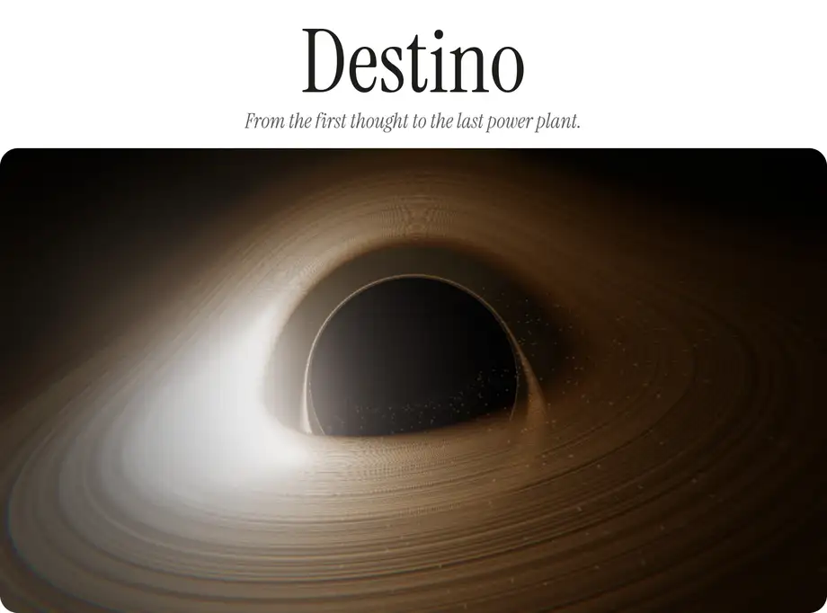
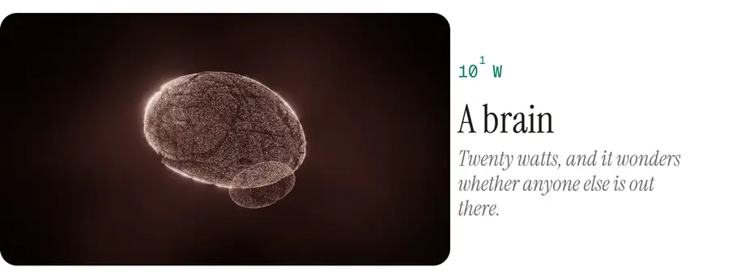
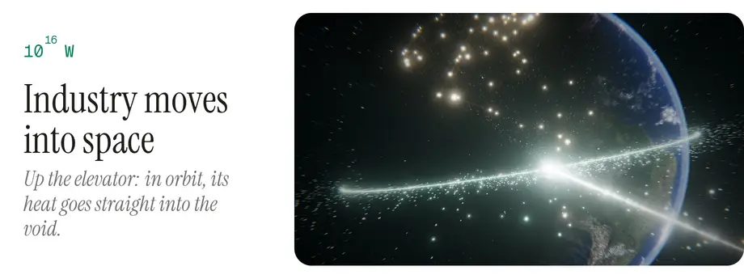
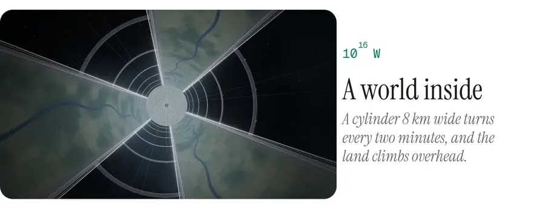
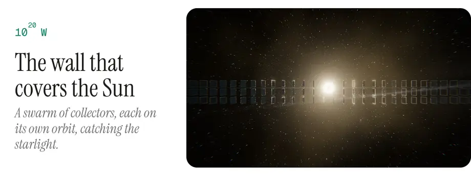
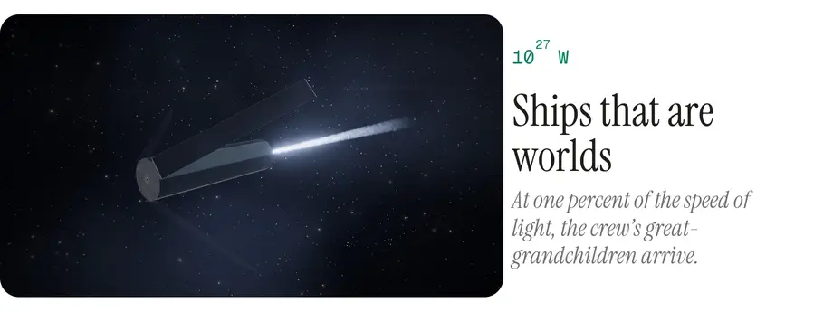
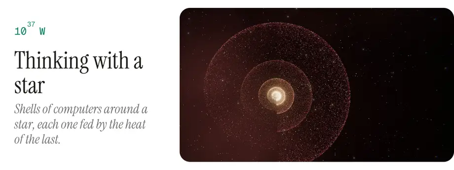

  <picture><source media="(prefers-color-scheme: dark)" type="image/avif" srcset="media/cover-dark.avif"><source media="(prefers-color-scheme: dark)" srcset="media/cover-dark.webp"><source type="image/avif" srcset="media/cover-light.avif"></picture>

  <picture><source media="(prefers-color-scheme: dark)" type="image/avif" srcset="media/brain-dark.avif"><source media="(prefers-color-scheme: dark)" srcset="media/brain-dark.webp"><source type="image/avif" srcset="media/brain-light.avif"></picture>

  <picture><source media="(prefers-color-scheme: dark)" type="image/avif" srcset="media/industry-dark.avif"><source media="(prefers-color-scheme: dark)" srcset="media/industry-dark.webp"><source type="image/avif" srcset="media/industry-light.avif"></picture>

  <picture><source media="(prefers-color-scheme: dark)" type="image/avif" srcset="media/inside-dark.avif"><source media="(prefers-color-scheme: dark)" srcset="media/inside-dark.webp"><source type="image/avif" srcset="media/inside-light.avif"></picture>

  <picture><source media="(prefers-color-scheme: dark)" type="image/avif" srcset="media/wall-dark.avif"><source media="(prefers-color-scheme: dark)" srcset="media/wall-dark.webp"><source type="image/avif" srcset="media/wall-light.avif"></picture>

  <picture><source media="(prefers-color-scheme: dark)" type="image/avif" srcset="media/ship-dark.avif"><source media="(prefers-color-scheme: dark)" srcset="media/ship-dark.webp"><source type="image/avif" srcset="media/ship-light.avif"></picture>

  <picture><source media="(prefers-color-scheme: dark)" type="image/avif" srcset="media/star-dark.avif"><source media="(prefers-color-scheme: dark)" srcset="media/star-dark.webp"><source type="image/avif" srcset="media/star-light.avif"></picture>

  <a href="https://drayzu.github.io/Destino/"><picture><source media="(prefers-color-scheme: dark)" srcset="media/enter-dark.svg"></picture></a>

 

How it's made

 

- The third piece of Horizontes (Espacio · Tiempo · Destino · Infinito): one scroll, about ten minutes, from “is anyone out there?” to the last thing a civilization could build, climbing the Kardashev scale from the twenty watts of a brain to a galaxy.
- One shared world in astronomical units with a pivoting camera, so the metres of a space elevator and the hundred thousand light years of the galaxy are exact in the same frame.
- Everything is points: the planets and the Sun come from the series' shared library of bodies, drawn over real maps (Solar System Scope, CC BY 4.0); habitats, swarms and light sails are points too.
- Physics where it counts: the light sail sees the sky with real aberration and Doppler shift, and brakes on Alpha Centauri's light (Heller & Hippke, 2017). A plate layer gives every figure its source.
- English and Spanish. Keys: `A` autoplay, `I` plate, `L` language; the ladder's rungs I, II and III jump to where the civilization reaches them.
- TypeScript, Three.js and Vite, no framework. `npm install`, `npm run dev`; pushing to `main` deploys to GitHub Pages.

