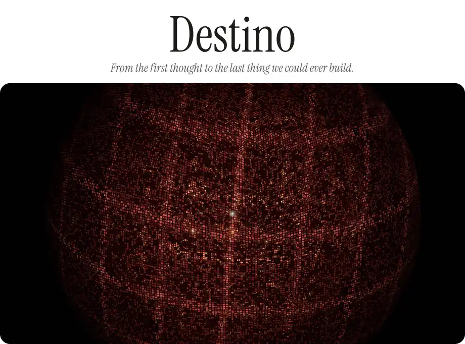
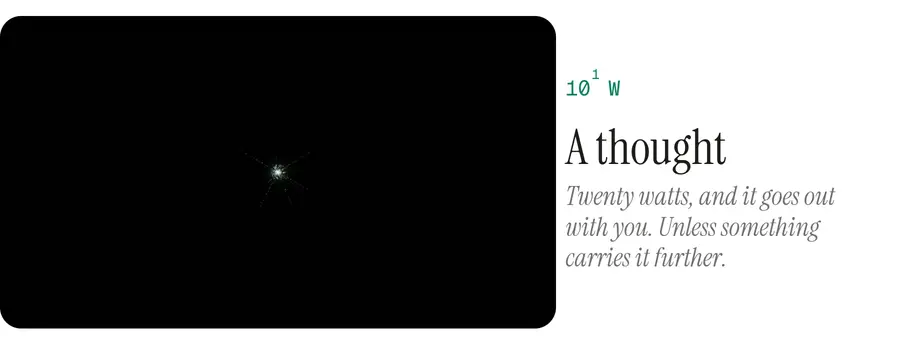
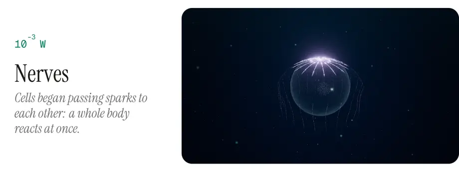
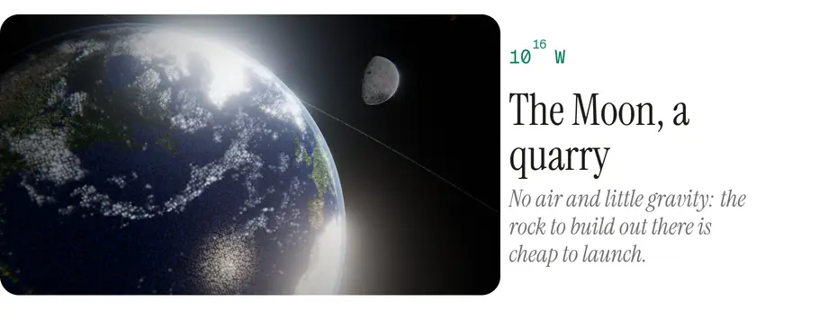
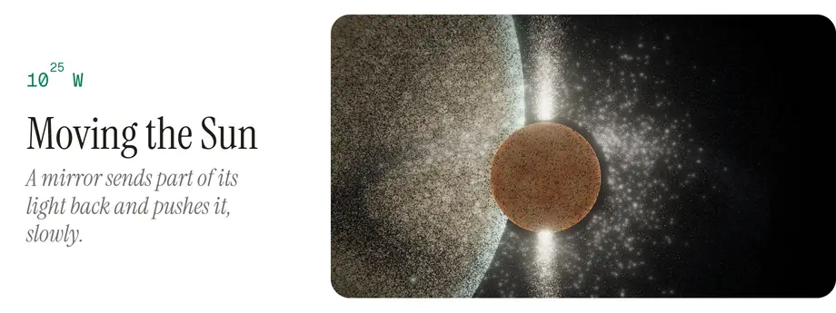
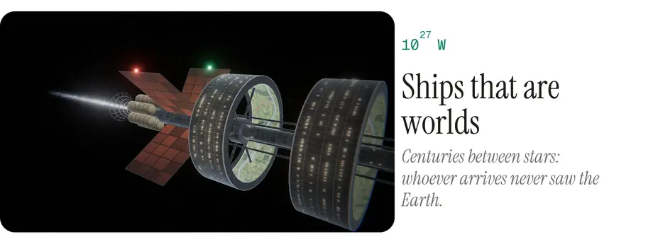
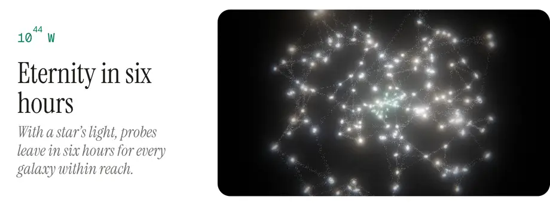

  <picture><source media="(prefers-color-scheme: dark)" type="image/avif" srcset="media/cover-dark.avif"><source media="(prefers-color-scheme: dark)" srcset="media/cover-dark.webp"><source type="image/avif" srcset="media/cover-light.avif"></picture>

  <picture><source media="(prefers-color-scheme: dark)" type="image/avif" srcset="media/thought-dark.avif"><source media="(prefers-color-scheme: dark)" srcset="media/thought-dark.webp"><source type="image/avif" srcset="media/thought-light.avif"></picture>

  <picture><source media="(prefers-color-scheme: dark)" type="image/avif" srcset="media/nerves-dark.avif"><source media="(prefers-color-scheme: dark)" srcset="media/nerves-dark.webp"><source type="image/avif" srcset="media/nerves-light.avif"></picture>

  <picture><source media="(prefers-color-scheme: dark)" type="image/avif" srcset="media/moon-dark.avif"><source media="(prefers-color-scheme: dark)" srcset="media/moon-dark.webp"><source type="image/avif" srcset="media/moon-light.avif"></picture>

  <picture><source media="(prefers-color-scheme: dark)" type="image/avif" srcset="media/sun-dark.avif"><source media="(prefers-color-scheme: dark)" srcset="media/sun-dark.webp"><source type="image/avif" srcset="media/sun-light.avif"></picture>

  <picture><source media="(prefers-color-scheme: dark)" type="image/avif" srcset="media/ship-dark.avif"><source media="(prefers-color-scheme: dark)" srcset="media/ship-dark.webp"><source type="image/avif" srcset="media/ship-light.avif"></picture>

  <picture><source media="(prefers-color-scheme: dark)" type="image/avif" srcset="media/web-dark.avif"><source media="(prefers-color-scheme: dark)" srcset="media/web-dark.webp"><source type="image/avif" srcset="media/web-light.avif"></picture>

  <a href="https://drayzu.github.io/Destino/"><picture><source media="(prefers-color-scheme: dark)" srcset="media/enter-dark.svg"></picture></a>

 

How it's made

 

- The third piece of Horizontes (Espacio · Tiempo · Destino · Infinito): one scroll, about twelve minutes, riding a thought, a teal spark that leaves your brain, from the twenty watts it costs to the last thing a civilization could build. A clock counts the watts, the year and how far we reach, from one world to everything within reach.
- Twelve acts, each a world at its own scale, handing over through a shared image instead of a cut, and the inner Solar System in one unbroken flight, from the Earth past the Moon, Mars and Venus to Mercury. The scroll's pace is read from the camera itself: flights take more of it, still moments less, and autoplay lasts as long as the words take to read.
- Points of light for the bodies (the series' shared library over real maps, Solar System Scope, CC BY 4.0), and surfaces of light where points are not enough: the land inside the rings of a ship that is a world, a light sail's film, the mirror that moves the Sun, the shells of computers round a star, a ray-traced black hole.
- Physics where it counts: aberration and Doppler at a fifth of the speed of light, braking on Alpha Centauri's light (Heller & Hippke, 2017), probes to every reachable galaxy (Armstrong & Sandberg, 2013). A plate layer gives each moment its figures and sources.
- English and Spanish. Keys: `A` autoplay, `I` plate, `L` language.
- TypeScript, Three.js and Vite, no framework. `npm install`, `npm run dev`; pushing to `main` deploys to GitHub Pages.

